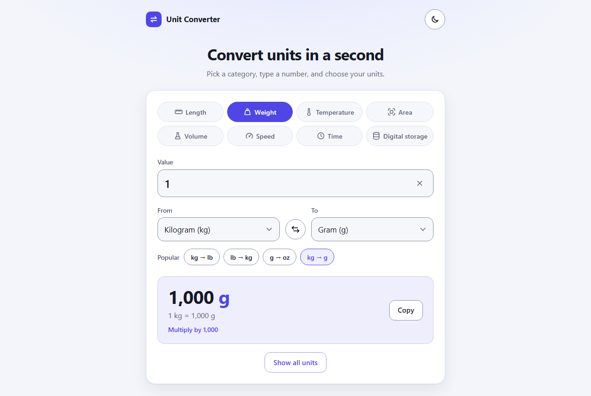
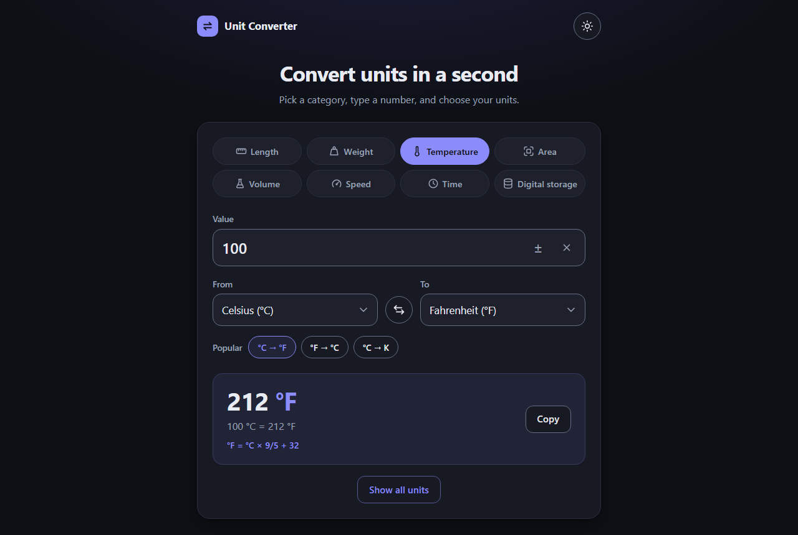
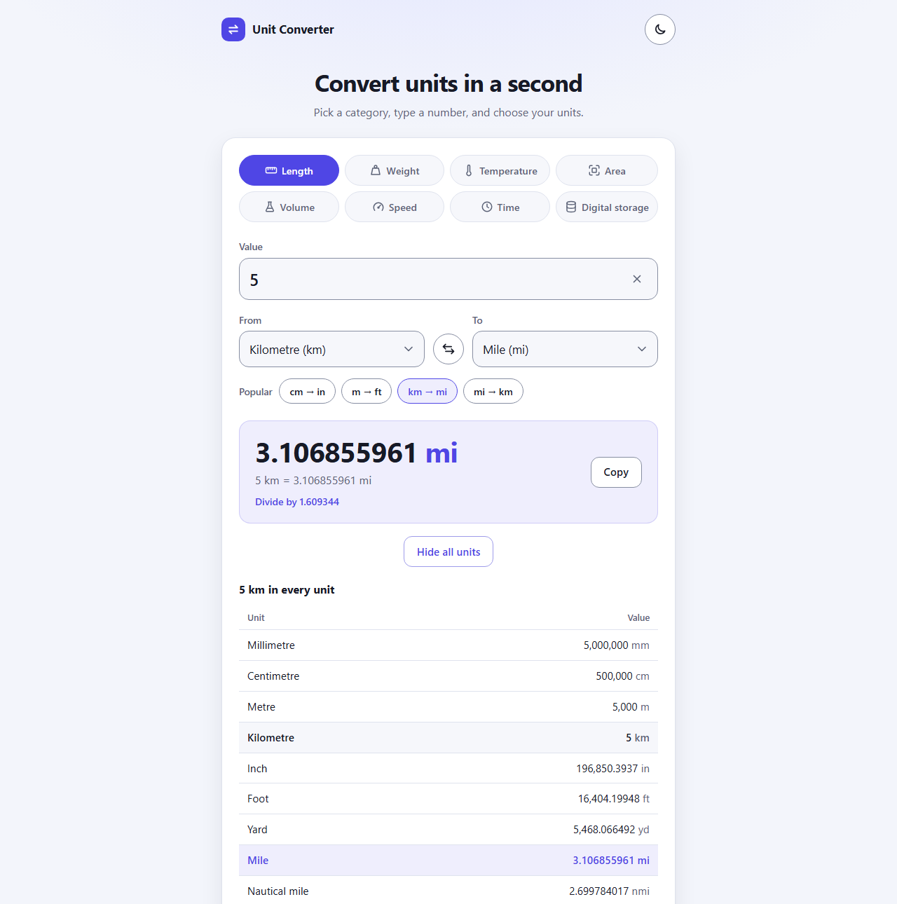
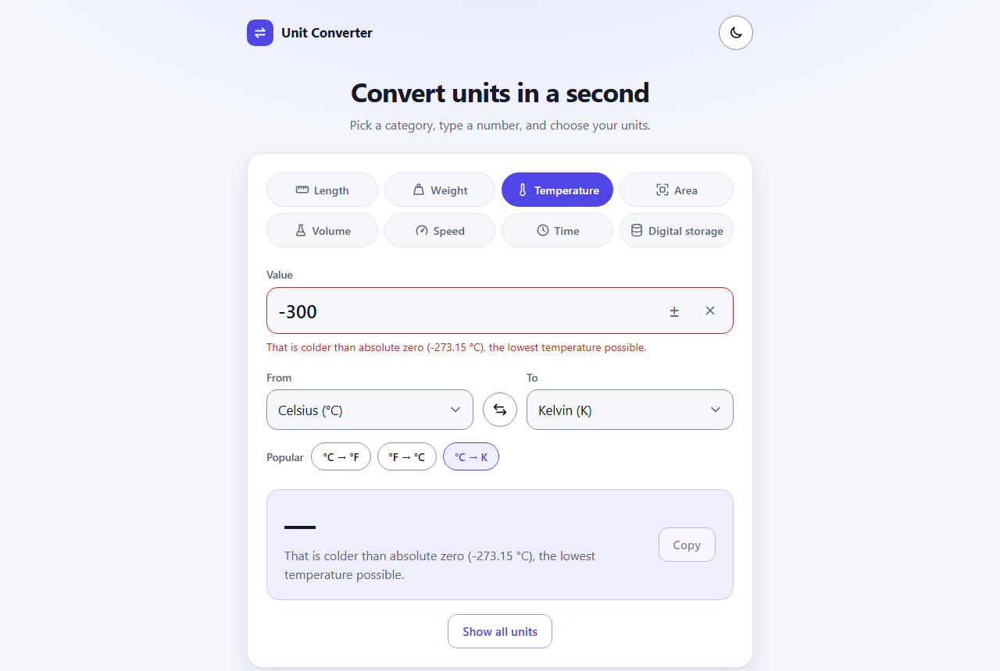
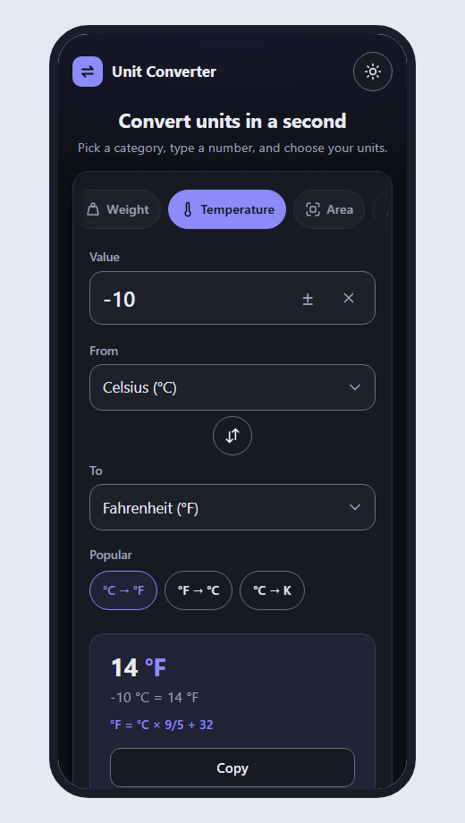

# Unit Converter

## What is this?

This is a small website. It changes a number from one unit to another unit.
For example: 1 kilogram is 1,000 grams. 100 °C is 212 °F.

It is a learning project. I practise three things here:
**pure functions**, **input validation** and **test cases**.

You don't need an account. There is no login.

## Screenshots

**Light mode**



**Dark mode**



**All units.** Press "Show all units" to see your number in every unit.



**Error message.** The app tells you when the input is wrong.



**On a phone** (light and dark)

<p>
  
  
</p>

## What can it do?

It has 8 groups of units:

| Group | Units |
|---|---|
| Length | millimetre, centimetre, metre, kilometre, inch, foot, yard, mile, nautical mile |
| Weight | milligram, gram, kilogram, tonne, ounce, pound, stone |
| Temperature | Celsius, Fahrenheit, Kelvin |
| Area | mm², cm², m², hectare, km², in², ft², yd², acre, mi² |
| Volume | millilitre, litre, m³, teaspoon, tablespoon, fluid ounce, cup, pint, quart, US gallon, UK gallon |
| Speed | m/s, km/h, mph, ft/s, knot |
| Time | millisecond, second, minute, hour, day, week, year |
| Digital storage | bit, byte, KB, MB, GB, TB, KiB, MiB, GiB |

You can change any unit to any other unit in the same group.
For example: kilograms to grams, grams to pounds, or km to miles.

Other things it can do:

- **Live answer.** The answer changes when you type. You don't need to press a button.
- **Formula.** Under the answer you see *how* it is made. For example: "Multiply by 1,000" or "°F = °C × 9/5 + 32".
- **Popular conversions.** Small buttons like "kg → lb". One tap sets both units.
- **Swap button (⇄).** It changes "From" and "To" around.
- **± button.** For temperature. It adds or takes away the minus. Phone keypads often have no minus key.
- **Clear button (×).** It empties the number box.
- **Show all units.** One button shows your number in every unit of the group. Press it again to hide the table.
- **Copy button.** It copies the answer.
- **Dark mode.** The moon button makes the page dark. The app remembers your choice.
- **Keyboard keys.** Press `/` to jump to the number box. Press `Esc` to clear it.
- **Share a link.** The web address has your numbers in it. You can save it or send it to a friend.
- **Clear errors.** For example: "Length can't be negative."
- **Phone friendly.** On a phone, the categories are one row. Swipe it left and right. The answer fits on the first screen.
- **For everyone.** It works with a keyboard and with a screen reader. The colours have good contrast.
- **Works without JavaScript.** Then you press the "Convert" button.

You can read how we planned the design in [docs/UI_UX_PLAN.md](docs/UI_UX_PLAN.md).

## What we use

| Name | What is it? | Why do we use it? |
|---|---|---|
| **Python 3.13** | A programming language. | We write the converter logic in Python. It is easy to read. |
| **Flask** | A small Python library for websites. | It shows the web page and answers the browser. |
| **HTML** | The language for web pages. | It makes the boxes, menus and buttons. |
| **CSS** | The language for styles. | It gives the page colours, space and dark mode. |
| **JavaScript** | The language that runs in the browser. | It updates the answer while you type. |
| **pytest** | A Python tool for tests. | It checks that our code gives the right answers. |
| **Git** | A tool that saves versions of the code. | We can see every change and go back if we need to. |
| **GitHub** | A website for Git projects. | Our code lives here, online. |
| **GitHub CLI (`gh`)** | GitHub in the terminal. | We make pull requests with it. |
| **VS Code** | A code editor. | We write and read the code in it. |
| **Claude Code** | An AI helper for coding. | It helped to plan, write and test this project. |
| **venv** | A private box for Python libraries. | This project's libraries don't mix with other projects. |
| **pip** | The Python tool to install libraries. | It installs Flask and pytest. |
| **Microsoft Edge** | A web browser. | We used it to take the screenshots. |

**Platform:** We build the app on **Windows 11**.
The app runs in any modern web browser: Chrome, Edge, Firefox or Safari.
It works on computers and on phones.

## How to start it

You need Python 3.13. These steps are for Windows.

1. Open a terminal in the project folder.
2. Make a virtual environment:
   ```
   python -m venv .venv
   ```
3. Install the libraries:
   ```
   .venv\Scripts\python -m pip install -r requirements.txt
   ```
4. Start the app:
   ```
   .venv\Scripts\flask --app converter run --debug
   ```
5. Open this address in your browser: http://127.0.0.1:5000
6. To stop the app, press `Ctrl + C` in the terminal.

## How to run the tests

```
.venv\Scripts\python -m pytest
```

You see a dot for every test that passes. At the end you see "passed".
There are more than 340 tests.

## Project folders

```
unit_converter/
  converter/           the app
    units.py           all the units and their sizes (only data)
    conversions.py     the maths (pure functions)
    validation.py      checks the user's input
    views.py           the web pages
    templates/         the HTML pages
    static/            the CSS and JavaScript files
  tests/               the tests
  docs/screenshots/    the pictures in this file
  docs/UI_UX_PLAN.md   the design plan
  requirements.txt     the list of libraries
```

## What I learn here

### 1. Pure functions

A pure function only uses what you give it. It gives the same answer every time.
It doesn't change anything outside.

```python
convert(1, "weight", "kilogram", "gram")   # always 1000.0
```

All the maths is in `converter/conversions.py`. There is no website code in it.
So it is very easy to test.

The formula line is a pure function too:

```python
describe_formula("weight", "gram", "kilogram")   # always "Divide by 1,000"
```

### 2. Input validation

Never trust the input. A person can type anything. A web address can have anything in it.
`converter/validation.py` checks everything before we do the maths:

- Is the box empty? → "Please enter a number."
- Are there letters? → "Please enter a number, like 12 or 3.5."
- Is the number too big? → "That number is too big."
- Is a length below zero? → "Length can't be negative."
- Is it colder than absolute zero (−273.15 °C)? → The app says no. Nothing can be that cold.
- Is the unit real, and in the right group? → If not: "Please choose a unit from the list."

The function gives back two things: the clean data and a list of errors.
If the error list is empty, the input is OK.

### 3. Test cases

A test runs the code and checks the answer. If the answer is wrong, the test fails.

```python
def test_kilogram_to_gram():
    assert convert(1, "weight", "kilogram", "gram") == 1000
```

The tests are in the `tests/` folder:

- `test_conversions.py`: known answers (1 kg = 1,000 g, 100 °C = 212 °F, and more).
  It also changes every unit to every other unit and back again. We must get the same number.
  It also checks the formula line, like "Divide by 1,000".
- `test_validation.py`: good input and bad input, and the error messages.
- `test_units.py`: the unit list has no mistakes. For example, every popular button uses real units.
- `test_views.py`: the web page and the API give the right answers.
