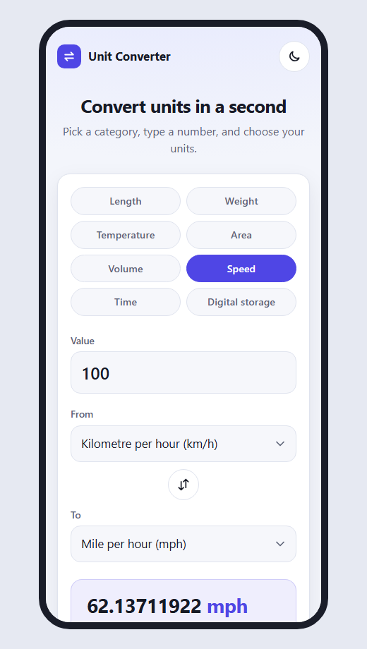
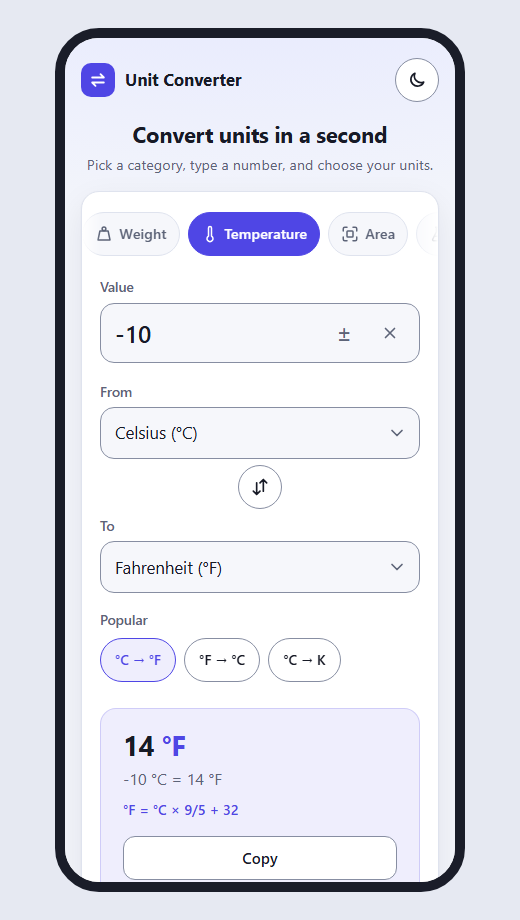

# UI/UX Plan

This plan is about how the Unit Converter **looks** (UI) and how **easy it is to use** (UX).
It looks at four areas: visual design, ease of use, the phone experience and accessibility.

## 1. Goals

- **Fast.** You get the answer in one or two steps.
- **Clear.** You always know what to do next.
- **For everyone.** It works with a mouse, a keyboard, a touch screen or a screen reader.
- **Any screen.** It looks good on a big computer and on a small phone.

## 2. Who uses it?

| Person | What do they want? |
|---|---|
| A student | Change units for homework. Understand *how* the answer is made. |
| A cook | Change cups to millilitres, quickly, with wet hands, on a phone. |
| A traveller | Change km/h to mph, or °F to °C, on a phone. |
| A computer user | Change GB to MB. They like the keyboard. |

## 3. What works well now

- The page is clean and simple: one card, one job.
- The answer changes while you type.
- Dark mode, and the app remembers it.
- It works without JavaScript.
- Error messages are clear and friendly.

## 4. Problems we found

| # | Problem | Area |
|---|---|---|
| 1 | On an iPhone, the number keypad has **no minus key**. You can't type −10 °C. | Phone |
| 2 | On a phone, the 8 category buttons use **4 rows**. The answer is pushed **below the screen**. | Phone |
| 3 | The category buttons are about 38px tall. Buttons for fingers should be **at least 44px**. | Phone, Accessibility |
| 4 | When you delete the number, a **red error** shows at once, but you are still typing. | Ease of use |
| 5 | The category buttons have **only words**. Pictures help you find them faster. | Visual design |
| 6 | Popular pairs like kg → lb need **two menu changes**. | Ease of use |
| 7 | The app shows the answer, but **not how** it got it. Students want to learn this. | Ease of use |
| 8 | A screen reader reads the **whole result card**, with the "Copy" button too. It doesn't say errors while you type. | Accessibility |

The phone today (before), with the answer below the first screen:

## 5. Changes

Priority: **High** = fix first, **Medium** = good to have.

### Visual design

| Change | Fixes | Priority |
|---|---|---|
| A small **icon** on each category button: ruler, weight, thermometer, and more. | 5 | Medium |
| A **formula line** under the answer, like "Multiply by 1,000" or "°F = °C × 9/5 + 32". | 7 | High |
| An empty box shows a **calm grey message**: "Type a number to convert". No red error. | 4 | High |
| The phone's browser bar takes the **page colour** (light or dark). | Look | Medium |

### Ease of use

| Change | Fixes | Priority |
|---|---|---|
| **Popular conversions**: small buttons like "kg → lb" or "°C → °F". One tap sets both units. | 6 | High |
| A **clear (×) button** in the number box. | Speed | Medium |
| **Keyboard keys**: `/` jumps to the number box. `Esc` clears it. | Speed | Medium |

### Phone

| Change | Fixes | Priority |
|---|---|---|
| A **± button** next to the number box, for temperature. It adds or removes the minus. | 1 | High |
| The category buttons are in **one row** that you swipe sideways. | 2 | High |
| **Less empty space** at the top, so the answer fits on the first screen. | 2 | High |
| All buttons are **at least 44px** tall. | 3 | High |

### Accessibility

| Change | Fixes | Priority |
|---|---|---|
| The screen reader reads **only the answer line**. If the input is wrong, the answer line says the error. | 8 | High |
| "Copied!" is **said out loud** by the screen reader. | 8 | Medium |
| The new buttons (±, ×, popular) have **clear names** for screen readers. Icons are hidden from them. | 8 | High |
| We **check the colours**. Text must have a contrast of at least 4.5 : 1, in light and dark mode. | Look | High |
| Everything works with the **keyboard only**, and you can always see where you are (focus ring). | Keyboard | High |

### Code (learning goals)

- The formula comes from a new **pure function**: `describe_formula(category, from_unit, to_unit)`.
  It is in `converter/conversions.py`, next to `convert()`, and it has its own tests.
- The popular pairs are **data** in `converter/units.py`. A test checks that every pair uses real units.
- Everything still works **without JavaScript**: the popular buttons are normal links.

## 6. Not now (ideas for later)

- **Install the app** on the phone, and use it offline (PWA).
- Choose **how many decimals** to show.
- **Recent conversions** and **favourites**.
- **More languages**.

## 7. Result

All the changes in part 5 are done. The phone after the changes:
the categories are one row, the ± button is there, and the answer is on the first screen.

  
  

The colour check found one problem: the borders of the boxes and buttons were too light (about 1.3 : 1).
Now they use a new, darker colour (`--control-border`), with at least 3 : 1 in light and dark mode.

## 8. How we check

1. **Tests:** `pytest` must pass. This includes new tests for the formula and the popular pairs.
2. **Browser test:** a small script clicks every new button in a real browser (Edge) and checks the result.
3. **Screenshots:** computer and phone, light and dark. On the phone, the answer must be on the first screen.
4. **Colour check:** a small script measures the contrast of every text colour.
5. **Keyboard test:** use the whole page with only the `Tab`, `Enter`, `/` and `Esc` keys.
6. **No JavaScript:** the category buttons, popular buttons, swap and "Convert" still work.
